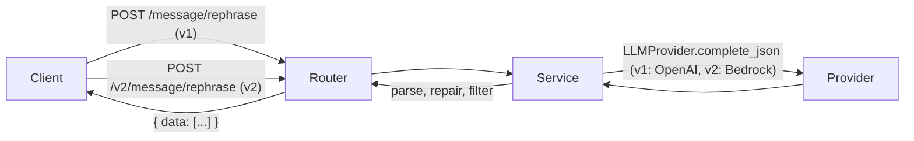

# SMS Rephrasing API


A small FastAPI service that takes a draft message and returns up to three
polished alternatives using an LLM, either OpenAI or Amazon Bedrock
(selected by configuration). Built to explore LLM
integration, prompt design and robust handling of imperfect model output.

## How it works



## Project structure

```
app/
├── main.py            # FastAPI app, error handling
├── config.py          # Typed settings from environment
└── messaging/
    ├── router.py      # HTTP layer
    ├── service.py     # Prompt + parsing, calls an LLMProvider
    ├── schemas.py     # Request/response models
    └── providers/     # LLMProvider protocol + OpenAI and Bedrock implementations
docs/api.md            # API reference
examples/              # Standalone experiments (streaming, auto-reply)
tests/                 # pytest suite (providers are mocked)
```

## Quick start

```bash
python -m venv .venv && source .venv/bin/activate
pip install -r requirements.txt
cp .env.example .env          # then add credentials (see Configuration)
uvicorn app.main:app --reload
```

Interactive docs: http://127.0.0.1:8000/docs

### Example

```bash
curl -X POST http://127.0.0.1:8000/message/rephrase \
  -H "Content-Type: application/json" \
  -d '{"message": "i wil com back soon", "member_id": "1", "workspace_id": "2"}'
```

```json
{ "data": ["I will be back soon.", "I'll return shortly."] }
```

The same request to `/v2/message/rephrase` is served by Amazon Bedrock.

| Version | Endpoint                    | Backend        |
|---------|-----------------------------|----------------|
| v1      | `POST /message/rephrase`    | OpenAI         |
| v2      | `POST /v2/message/rephrase` | Amazon Bedrock |

Both endpoints share the same request and response schema, and can be used at
the same time. You only need credentials for the endpoints you call.

See [docs/api.md](docs/api.md) for the full API reference.

## Configuration

| Variable           | Provider | Default       | Purpose                                  |
|--------------------|----------|---------------|------------------------------------------|
| `OPEN_AI_SECRET`   | v1       | (none)        | OpenAI API key; v1 returns 502 without it |
| `OPENAI_MODEL`     | v1       | `gpt-4o-mini` | OpenAI model                             |
| `AWS_REGION`       | v2       | `us-east-1`   | Region where the model is enabled        |
| `LLM_TIMEOUT_SECONDS` | v1, v2 | `30`          | Connect/read timeout for provider calls  |
| `BEDROCK_MODEL_ID` | v2       | Claude Haiku inference profile | Bedrock model or inference profile ID |

### OpenAI (v1)

```bash
OPEN_AI_SECRET=sk-...
```

### Amazon Bedrock (v2)

```bash
AWS_REGION=us-east-1
BEDROCK_MODEL_ID=us.anthropic.claude-haiku-4-5-20251001-v1:0   # optional, this is the default
```

AWS credentials are resolved by the standard AWS
(boto3) credential chain: `AWS_ACCESS_KEY_ID` / `AWS_SECRET_ACCESS_KEY`
environment variables, a profile in `~/.aws` (optionally via `AWS_PROFILE`),
an IAM role (ECS/EKS/EC2/Lambda), or a Bedrock API key. For a Bedrock API key
set `AWS_BEARER_TOKEN_BEDROCK` in `.env` or export it in your shell; the app
passes it to boto3. Never commit keys.

Requirements:

- The identity needs the `bedrock:InvokeModel` IAM permission on the model.
- Model access must be enabled for that model in your Bedrock console, in
  the configured `AWS_REGION`.

The default model ID is a `us.` inference profile, so use a US `AWS_REGION` or set
`BEDROCK_MODEL_ID` to a profile valid for your region. Forced tool use
(`toolChoice`) is supported by Claude models on Converse; other Bedrock models
may not support it. Inference profiles may also need `bedrock:InvokeModel` on
the profile and underlying foundation-model ARNs.

Invalid settings (for example a non-positive `LLM_TIMEOUT_SECONDS`) make the
app fail at startup rather than per request.

If the provider fails or is unreachable (bad credentials, no model access,
throttling, network, or a missing `OPEN_AI_SECRET` on v1), the API returns
`502` "AI provider unavailable". This applies to both endpoints.

### Docker

```bash
docker build -t sms-rephrasing .
docker run -p 8000:8000 --env-file .env \
  -e AWS_ACCESS_KEY_ID -e AWS_SECRET_ACCESS_KEY sms-rephrasing   # v1 and v2
```

On AWS, prefer an IAM role over passing keys.

## Tests

```bash
pip install -r requirements-dev.txt
pytest
```

## Design decisions

- **Provider abstraction.** The service depends on an `LLMProvider` protocol
  (`app/messaging/providers/`), not on a vendor SDK. The API version picks the implementation: v1 uses OpenAI, v2 uses Bedrock.
- **Event loop stays free.** The OpenAI client is async; the Bedrock boto3 client is sync and runs in a worker thread. Both have a request timeout (`LLM_TIMEOUT_SECONDS`).
- **Structured output on both providers.** OpenAI uses a JSON schema response
  format. Bedrock uses the Converse API with forced tool use (`toolChoice`),
  so the reply is a parseable tool input. No string repair is needed.
  Incomplete sentences are still filtered out.
- **Dependency injection** (`Depends`) lets tests swap in a fake service.
- **Provider failures map to a clean `502`** instead of leaking a stack trace.
- **Model is configurable** via `OPENAI_MODEL` / `BEDROCK_MODEL_ID`, so upgrading needs no code change.

### Adding another provider

1. Add a class in `providers/` implementing the `LLMProvider` protocol.
2. Wrap vendor SDK errors in the shared provider error so they map to `502`.
3. Register it in the provider factory and add its settings to `config.py`.
4. Expose it as a new API version (a router under `/vN`) with its own
   dependency in `service.py`, and add a mocked test.

## Roadmap

- [x] Structured outputs instead of JSON repair
- [x] Amazon Bedrock provider, served at `/v2/message/rephrase`
- [ ] Streaming suggestions
- [ ] Evaluation set to score suggestion quality
- [ ] Token cost and latency logging
- [x] Dockerfile (`docker build -t sms-rephrasing .`)
