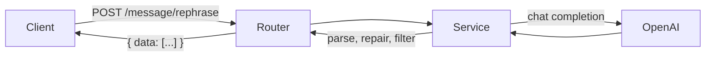

# SMS Rephrasing API


A small FastAPI service that takes a draft message and returns up to three
polished alternatives using an OpenAI chat model. Built to explore LLM
integration, prompt design and robust handling of imperfect model output.

## How it works



## Project structure

```
app/
├── main.py            # FastAPI app and routes wiring
├── config.py          # Environment-based settings
└── messaging/
    ├── router.py      # HTTP layer
    ├── service.py     # OpenAI call and output parsing
    └── schemas.py     # Request/response models
examples/              # Standalone experiments (streaming, auto-reply)
tests/                 # pytest suite (OpenAI is mocked)
```

## Quick start

```bash
python -m venv .venv && source .venv/bin/activate
pip install -r requirements.txt
cp .env.example .env          # then add your OpenAI API key
uvicorn app.main:app --reload
```

Interactive docs: http://127.0.0.1:8000/docs

### Example

```bash
curl -X POST http://127.0.0.1:8000/message/rephrase \
  -H "Content-Type: application/json" \
  -d '{"message": "i wil com back soon", "member_id": "1", "workspace_id": "2"}'
```

```json
{ "data": ["I will be back soon.", "I'll return shortly."] }
```

## Tests

```bash
pip install -r requirements-dev.txt
pytest
```

## Design decisions

- **Sync OpenAI client in a worker thread** (`asyncio.to_thread`) keeps the
  event loop free without adding an async dependency.
- **`max_tokens` is kept low for latency**, so replies can be cut off. The
  service repairs a truncated JSON array and drops any suggestion that is not
  a complete sentence rather than showing partial text.
- **Model is configurable** via `OPENAI_MODEL`, so upgrading needs no code change.
- **The OpenAI client is created once** and reused across requests.

## Roadmap

- [ ] Structured outputs instead of JSON repair
- [ ] Streaming suggestions
- [ ] Evaluation set to score suggestion quality
- [ ] Token cost and latency logging
- [ ] Dockerfile
