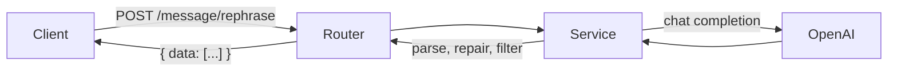

# SMS Rephrasing API


A small FastAPI service that takes a draft message and returns up to three
polished alternatives using an OpenAI chat model. Built to explore LLM
integration, prompt design and robust handling of imperfect model output.

## How it works



## Project structure

```
app/
├── main.py            # FastAPI app, error handling
├── config.py          # Typed settings from environment
└── messaging/
    ├── router.py      # HTTP layer
    ├── service.py     # OpenAI call (structured JSON output)
    └── schemas.py     # Request/response models
docs/api.md            # API reference
examples/              # Standalone experiments (streaming, auto-reply)
tests/                 # pytest suite (OpenAI is mocked)
```

## Quick start

```bash
python -m venv .venv && source .venv/bin/activate
pip install -r requirements.txt
cp .env.example .env          # then add your OpenAI API key
uvicorn app.main:app --reload
```

Interactive docs: http://127.0.0.1:8000/docs

### Example

```bash
curl -X POST http://127.0.0.1:8000/message/rephrase \
  -H "Content-Type: application/json" \
  -d '{"message": "i wil com back soon", "member_id": "1", "workspace_id": "2"}'
```

```json
{ "data": ["I will be back soon.", "I'll return shortly."] }
```

See [docs/api.md](docs/api.md) for the full API reference.

## Tests

```bash
pip install -r requirements-dev.txt
pytest
```

## Design decisions

- **Async OpenAI client** keeps the event loop free.
- **Structured JSON output** (JSON schema) guarantees a parseable reply, so no
  string repair is needed. Incomplete sentences are still filtered out.
- **Dependency injection** (`Depends`) lets tests swap in a fake service.
- **OpenAI failures map to a clean `502`** instead of leaking a stack trace.
- **Model is configurable** via `OPENAI_MODEL`, so upgrading needs no code change.

## Roadmap

- [x] Structured outputs instead of JSON repair
- [ ] Streaming suggestions
- [ ] Evaluation set to score suggestion quality
- [ ] Token cost and latency logging
- [x] Dockerfile (`docker build -t sms-rephrasing .`)
